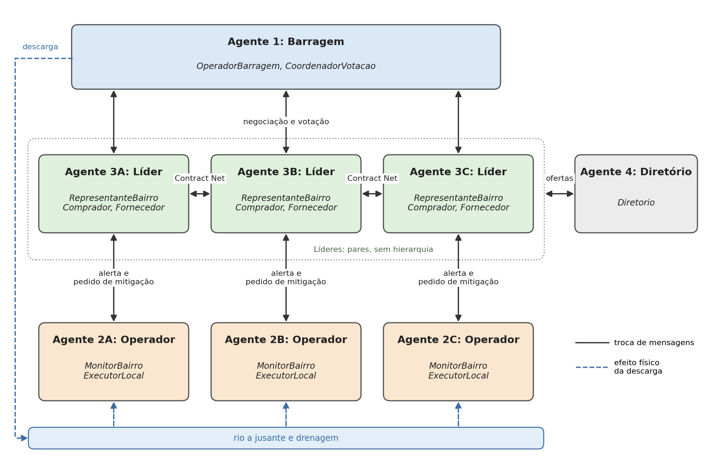

# 9. Análise e design segundo a metodologia Gaia

Esta seção descreve o sistema com a metodologia Gaia, na versão estendida de Zambonelli, Jennings e Wooldridge (2003). O Gaia trata um sistema multiagente como uma organização e divide o trabalho em três fases. A análise identifica papéis, interações e regras. O design arquitetural fixa a estrutura da organização. O design detalhado define os tipos de agente e os serviços de cada um. O Gaia não depende de plataforma, por isso a subseção 9.4 liga o design ao SPADE.

## 9.1. Análise

### 9.1.1. Suborganizações

O sistema tem três suborganizações. Cada uma tem um objetivo próprio, e os seus membros interagem mais entre si do que com o resto do sistema.

| Suborganização | Objetivo | Papéis envolvidos |
|---|---|---|
| Gestão da descarga | Decidir caudal, horário e duração das descargas da barragem | OperadorBarragem, CoordenadorVotacao, RepresentanteBairro |
| Resposta local (uma por bairro) | Detectar o risco no bairro e aplicar medidas de mitigação | MonitorBairro, ExecutorLocal, RepresentanteBairro |
| Mercado de serviços | Contratar recursos entre bairros | Comprador, Fornecedor, Diretorio, ExecutorLocal |

O líder comunitário participa das três suborganizações, por isso é o agente que as liga.

### 9.1.2. Modelo do ambiente

No Gaia, o ambiente é um conjunto de recursos que os papéis podem ler (reads) ou alterar (changes). A notação [X] indica um recurso por bairro (A, B ou C).

| Recurso | Descrição | Lido por | Alterado por |
|---|---|---|---|
| nivel_reservatorio | Percentagem de enchimento do reservatório | OperadorBarragem | Ambiente (precipitação, caudais) |
| precipitacao, caudal_entrada | Chuva e água que entra no reservatório | OperadorBarragem, MonitorBairro | Ambiente |
| caudal_saida | Caudal libertado pelas comportas | OperadorBarragem | OperadorBarragem |
| limites_seguranca | Caudal máximo seguro e nível máximo do reservatório | OperadorBarragem | Ninguém (valores fixos da configuração) |
| nivel_jusante | Nível da água a jusante da barragem | OperadorBarragem | Ambiente, em função de caudal_saida |
| nivel_agua[X] | Nível da água no bairro | MonitorBairro[X] | Ambiente, ExecutorLocal |
| humidade_solo[X], capacidade_drenagem[X] | Estado do solo e da drenagem do bairro | MonitorBairro[X] | Ambiente, ExecutorLocal[X] |
| estoque[X] | Bombas, sacos de areia, barreiras e equipes do bairro | ExecutorLocal[X], Fornecedor[X] | ExecutorLocal[X] |
| reservado[X] | Parte do estoque presa a contratos em curso | ExecutorLocal[X], Fornecedor[X] | Fornecedor[X] |
| moeda[X] | Saldo fictício do bairro | Comprador[X], Fornecedor[X] | Comprador[X] (paga), Fornecedor[X] (recebe) |
| registro_ofertas | Ofertas publicadas: serviço, preço, fornecedor, disponibilidade | Comprador, Diretorio | Diretorio, a pedido do Fornecedor |

Cada papel de um bairro só acede aos recursos desse bairro. A única exceção é o ExecutorLocal que executa um serviço contratado: ele altera nivel_agua do bairro comprador.

### 9.1.3. Modelo de papéis preliminar

| Papel | Descrição | Agente que o desempenha |
|---|---|---|
| OperadorBarragem | Monitora o reservatório, propõe e reformula planos de descarga, valida a segurança e executa a operação autorizada ou a contingência | Agente 1 |
| CoordenadorVotacao | Submete a proposta final aos três líderes, recolhe os votos e apura o resultado | Agente 1 |
| MonitorBairro | Mede as condições do bairro, classifica o risco e alerta o líder | Agentes 2A, 2B, 2C |
| ExecutorLocal | Controla o estoque físico, ativa bombas, barreiras e equipes, executa serviços contratados | Agentes 2A, 2B, 2C |
| RepresentanteBairro | Define as prioridades do bairro, responde às propostas de descarga e vota | Agentes 3A, 3B, 3C |
| Comprador | Procura no diretório e contrata recursos de outro bairro quando falta estoque local | Agentes 3A, 3B, 3C |
| Fornecedor | Publica ofertas, responde a pedidos de propostas e recebe o pagamento | Agentes 3A, 3B, 3C |
| Diretorio | Guarda as ofertas e responde às consultas, sem tomar decisões | Agente 4 |

A votação é um papel separado do OperadorBarragem porque a especificação pede que seja implementada à parte da negociação (seção 6).

### 9.1.4. Modelo de interações preliminar

| Protocolo | Iniciador e respondedor | Performativas | Conteúdo | Resultado |
|---|---|---|---|---|
| AlertarRisco | MonitorBairro para RepresentanteBairro do mesmo bairro | INFORM | bairro, risco, nível, velocidade de subida | O líder atualiza as prioridades |
| PedirMitigacao | RepresentanteBairro para ExecutorLocal do mesmo bairro | REQUEST; AGREE ou REFUSE; INFORM ou FAILURE | recursos e quantidades | Recursos ativados, ou pedido recusado por falta de estoque |
| InformarEstadoBarragem | OperadorBarragem para os 3 RepresentanteBairro | INFORM | nível, caudais, previsão | Os líderes conhecem o estado da barragem |
| NegociarDescarga | OperadorBarragem para os 3 RepresentanteBairro | PROPOSE; ACCEPT-PROPOSAL, REJECT-PROPOSAL ou PROPOSE (alternativa) | id_negociacao, id_proposta, rodada, caudal, horário, duração | Proposta final, ou fim sem acordo |
| Votacao | CoordenadorVotacao para os 3 RepresentanteBairro | PROPOSE (proposta final); ACCEPT-PROPOSAL ou REJECT-PROPOSAL | id_negociacao, id_proposta | Proposta aprovada ou rejeitada |
| InformarDecisao | OperadorBarragem para os 3 RepresentanteBairro | INFORM | decisão, descarga executada ou contingência, motivo | Os líderes sabem o que foi executado |
| AvisoDescarga | OperadorBarragem para os 3 MonitorBairro | INFORM | caudal, horário, duração | Os operadores contam com a subida do nível |
| GerirOferta | Fornecedor para Diretorio | REQUEST (publicar, atualizar ou remover); AGREE ou REFUSE | serviço, preço, quantidade, disponibilidade | Registro de ofertas atualizado |
| ConsultarOfertas | Comprador para Diretorio | REQUEST; INFORM | serviço procurado | Lista de fornecedores e preços |
| ContractNet | Comprador para um ou mais Fornecedor | CFP; PROPOSE ou REFUSE; ACCEPT-PROPOSAL, REJECT-PROPOSAL ou PROPOSE (contraproposta) | id_negociacao, serviço, quantidade, preço | Contrato fechado e recurso reservado, ou sem acordo |
| ExecutarServico | Fornecedor para ExecutorLocal do bairro fornecedor | REQUEST; AGREE; INFORM ou FAILURE | serviço, quantidade, bairro de destino | Serviço executado, ou falha |
| ConfirmarServico | Fornecedor para Comprador | INFORM ou FAILURE | id_negociacao, resultado | O comprador paga, ou o contrato é cancelado |
| Pagamento | Comprador para Fornecedor | INFORM | id_negociacao, valor | Moeda transferida |

### 9.1.5. Regras organizacionais

As regras organizacionais valem para a organização inteira, acima de cada papel. O Gaia separa regras de vivacidade, que fixam a ordem das interações, de regras de segurança, que nunca podem ser violadas.

Regras de vivacidade:

1. A votação só começa quando a negociação produz uma proposta final. NegociarDescarga vem sempre antes de Votacao.
2. Uma descarga só é executada depois de uma votação aprovada e da validação técnica, ou como contingência. Nos dois casos, segue-se InformarDecisao.
3. A negociação da descarga tem no máximo N_max rodadas. Se terminar sem acordo, o OperadorBarragem aplica a contingência.
4. No Contract Net, o pagamento só acontece depois de ConfirmarServico com sucesso. Uma FAILURE libera a reserva e cancela o pagamento.

Regras de segurança:

5. caudal_saida ≤ caudal_max_seguro, seja qual for o resultado da votação.
6. Cada RepresentanteBairro vota uma vez por votação, e o OperadorBarragem não vota. Uma proposta é aprovada se tiver pelo menos 2 votos favoráveis em 3.
7. Um Fornecedor só oferece um recurso se estoque − reservado − quantidade ≥ reserva_minima.
8. Um Comprador só aceita uma proposta cujo preço caiba na moeda disponível do bairro.
9. O Comprador abre a negociação com cerca de 60% do preço base. O Fornecedor aceita valores iguais ou superiores a 70% do preço base e contrapropõe abaixo disso.
10. O Comprador e o Fornecedor de uma transação pertencem a bairros diferentes.
11. O Diretorio só altera uma oferta a pedido do Fornecedor que a publicou.

## 9.2. Design arquitetural

### 9.2.1. Estrutura organizacional

O sistema não tem entidade central. A Figura 1 mostra as relações entre os papéis, agrupados por agente.



*Figura 1. Estrutura organizacional. As setas contínuas indicam troca de mensagens. As setas tracejadas indicam o efeito físico de uma descarga, que chega aos bairros pelo rio e pela drenagem. O Contract Net pode ligar quaisquer dois líderes, não só os vizinhos na figura.*

As relações são de quatro tipos:

- Os três líderes são pares. Têm o mesmo estatuto, nenhum manda nos outros, e negociam e contratam diretamente entre si.
- O OperadorBarragem tem autoridade técnica sobre as comportas, mas não manda nos líderes. Uma descarga normal depende da votação, e a votação não pode autorizar uma operação insegura.
- Dentro de cada bairro, o líder pede e o operador executa. O operador pode recusar quando o estoque não chega, porque é ele quem controla os recursos físicos. O líder controla a moeda e as decisões comerciais.
- O Diretorio é um serviço passivo. Todos os líderes o consultam e ninguém lhe obedece.

Esta estrutura segue as restrições da especificação. A ausência de entidade central e a votação exigem líderes em pé de igualdade. A segurança exige que uma única entidade responda tecnicamente pela barragem. A separação entre estoque e moeda vem da seção 5.3.

### 9.2.2. Modelo de papéis

Cada papel tem responsabilidades de vivacidade (o que o papel acaba sempre por fazer) e de segurança (o que nunca pode deixar de valer). As expressões de vivacidade usam a notação do Gaia:

| Operador | Significado |
|---|---|
| x . y | x seguido de y |
| x \| y | x ou y |
| x* | x zero ou mais vezes |
| x+ | x uma ou mais vezes |
| xω | x repetido indefinidamente |
| [x] | x opcional |
| x \|\| y | x e y intercalados (em paralelo) |

Os nomes nas expressões são protocolos da tabela 9.1.4 ou atividades. Uma atividade é uma ação interna do papel, sem troca de mensagens. Por baixo de cada papel listam-se as suas atividades.

**OperadorBarragem**

```
OperadorBarragem = (MonitorarReservatorio . [InformarEstadoBarragem])ω || (CicloDescarga)ω
CicloDescarga    = AvaliarNecessidade . NegociarDescarga . Decidir . InformarDecisao . [AvisoDescarga]
NegociarDescarga = ProporDescarga . (ReceberRespostas . ReformularProposta)* . EncerrarNegociacao
Decidir          = (ReceberResultado . ValidarSeguranca . ExecutarDescarga) | ExecutarContingencia | Adiar
```

Atividades: MonitorarReservatorio, AvaliarNecessidade, ReformularProposta, ValidarSeguranca, ExecutarDescarga, ExecutarContingencia, Adiar. ReceberResultado é o resultado entregue pelo papel CoordenadorVotacao, que corre no mesmo agente.

Segurança: caudal_saida ≤ caudal_max_seguro; rodada ≤ N_max; ExecutarDescarga só com proposta aprovada e validada.

**CoordenadorVotacao**

```
CoordenadorVotacao = (Votacao . ApurarVotos . EntregarResultado)ω
```

Atividades: ApurarVotos, EntregarResultado.

Segurança: no máximo um voto por líder em cada id_negociacao; aprovado se e só se votos favoráveis ≥ 2; um líder que não responde no prazo conta como voto contra.

**MonitorBairro**

```
MonitorBairro = (Medir . AvaliarRisco . [AlertarRisco])ω || (AvisoDescarga)ω
```

Atividades: Medir, AvaliarRisco. AlertarRisco acontece quando o risco muda de classe ou quando o nível sobe depressa.

Segurança: risco ∈ {baixo, moderado, elevado, crítico}.

**ExecutorLocal**

```
ExecutorLocal = (PedirMitigacao . [AtivarRecursos])ω || (ExecutarServico . [AtivarRecursosNoDestino])ω
```

Atividades: AtivarRecursos, AtivarRecursosNoDestino.

Segurança: estoque ≥ 0 para cada recurso; reservado ≤ estoque.

**RepresentanteBairro**

```
RepresentanteBairro = (AlertarRisco . DefinirPrioridades . [PedirMitigacao])ω
                      || (InformarEstadoBarragem)ω
                      || (NegociarDescarga . Votacao . InformarDecisao)ω
```

Atividades: DefinirPrioridades (a partir do risco local, da população afetada e dos recursos), AvaliarProposta (dentro de NegociarDescarga e Votacao).

Segurança: um voto por id_negociacao.

**Comprador**

```
Comprador = (IdentificarNecessidade . ConsultarOfertas . ContractNet . [ConfirmarServico . [Pagamento]])ω
```

Atividades: IdentificarNecessidade (risco elevado ou crítico e estoque local insuficiente).

Segurança: preço aceito ≤ moeda; Pagamento só depois de ConfirmarServico com sucesso.

**Fornecedor**

```
Fornecedor = (AvaliarExcedente . GerirOferta)ω
             || (ContractNet . [ReservarRecurso . ExecutarServico . ConfirmarServico . (Pagamento | LiberarReserva)])ω
```

Atividades: AvaliarExcedente, ReservarRecurso, LiberarReserva.

Segurança: estoque − reservado ≥ reserva_minima; preço aceito ≥ 0,7 × preço base.

**Diretorio**

```
Diretorio = (GerirOferta | ConsultarOfertas)ω
```

Atividades: nenhuma além de guardar e devolver ofertas.

Segurança: uma oferta só muda a pedido do Fornecedor que a publicou.

### 9.2.3. Modelo de interações

A tabela 9.1.4 é o modelo de interações final. Todas as mensagens seguem o mesmo formato. Os metadados FIPA identificam a performativa, o protocolo e a conversa (conversation-id, que no SPADE é o campo thread). O corpo vai em JSON e leva os dados da tabela. Exemplo de uma proposta na segunda rodada da negociação da descarga:

```
performative: propose
protocol:     negociar-descarga
thread:       desc-007
body: {
  "tipo": "proposta_descarga",
  "id_negociacao": "desc-007",
  "id_proposta": "desc-007-r2",
  "rodada": 2,
  "caudal": 40.0,
  "horario": 3,
  "duracao": 10
}
```

O campo thread permite que um agente com várias conversas abertas, como o líder que negocia uma descarga enquanto contrata uma bomba, encaminhe cada resposta para a conversa certa.

## 9.3. Design detalhado

### 9.3.1. Modelo de agentes

| Tipo de agente | Papéis | Instâncias | Agentes da arquitetura |
|---|---|---|---|
| AgenteBarragem | OperadorBarragem, CoordenadorVotacao | 1 | Agente 1 |
| AgenteOperadorBairro | MonitorBairro, ExecutorLocal | 3 | Agentes 2A, 2B, 2C |
| AgenteLider | RepresentanteBairro, Comprador, Fornecedor | 3 | Agentes 3A, 3B, 3C |
| AgenteDiretorio | Diretorio | 1 | Agente 4 |

Os papéis que partilham recursos ficam no mesmo agente. O OperadorBarragem e o CoordenadorVotacao trabalham sobre a mesma proposta. O MonitorBairro e o ExecutorLocal leem e alteram nivel_agua e estoque do mesmo bairro. Os três papéis do líder usam a mesma moeda e as mesmas prioridades. Comprador e Fornecedor estão no mesmo agente porque um bairro pode comprar num momento e vender noutro.

### 9.3.2. Modelo de serviços

| Serviço | Agente | Entradas | Saídas | Pré-condição | Pós-condição |
|---|---|---|---|---|---|
| Monitorar reservatório | AgenteBarragem | nível, caudais, precipitação | estado da barragem | nenhuma | estado atualizado |
| Propor descarga | AgenteBarragem | nível, limites de segurança | proposta (caudal, horário, duração) | nivel_reservatorio acima do nível de alerta | proposta enviada aos 3 líderes, rodada = 1 |
| Reformular proposta | AgenteBarragem | respostas dos líderes | nova proposta | rodada < N_max e pelo menos uma rejeição ou alternativa | rodada aumentada em 1 |
| Apurar votação | AgenteBarragem | proposta final, votos | aprovada ou rejeitada | negociação encerrada | resultado entregue ao OperadorBarragem |
| Executar descarga | AgenteBarragem | proposta aprovada | novo caudal_saida | proposta aprovada e caudal ≤ caudal_max_seguro | nível do reservatório desce; líderes e operadores informados |
| Executar contingência | AgenteBarragem | estado da barragem | caudal de contingência | sem acordo a tempo, ou emergência | caudal ≤ caudal_max_seguro; líderes informados |
| Avaliar risco local | AgenteOperadorBairro | nível, velocidade de subida, precipitação, drenagem | classe de risco | nenhuma | se o risco mudou ou o nível subiu depressa, líder alertado |
| Ativar mitigação | AgenteOperadorBairro | recursos pedidos | INFORM ou FAILURE | estoque suficiente | estoque reduzido; nível da água do bairro reduzido |
| Executar serviço contratado | AgenteOperadorBairro | serviço, quantidade, bairro de destino | INFORM ou FAILURE | recurso reservado | recurso usado no bairro comprador; reserva consumida |
| Responder a proposta de descarga | AgenteLider | proposta, risco do bairro | aceitação, rejeição ou alternativa | negociação aberta | resposta enviada |
| Votar | AgenteLider | proposta final | voto | votação aberta e líder ainda não votou | voto enviado |
| Publicar oferta | AgenteLider | estoque, reserva mínima, preços | oferta no diretório | estoque acima da reserva mínima | oferta registrada |
| Contratar serviço | AgenteLider | necessidade, ofertas | contrato | risco elevado ou crítico e estoque local insuficiente | recurso reservado no bairro fornecedor, ou sem acordo |
| Liquidar pagamento | AgenteLider | confirmação de execução | transferência de moeda | serviço confirmado | moeda do comprador desce, a do fornecedor sobe |
| Registrar e consultar ofertas | AgenteDiretorio | pedido de um líder | confirmação ou lista de ofertas | pedido de publicação vem do dono da oferta | registro atualizado ou lista devolvida |

## 9.4. Correspondência com o SPADE

Cada tipo de agente do Gaia corresponde a uma classe SPADE, e cada responsabilidade de vivacidade corresponde a um ou mais behaviours. Uma repetição indefinida (xω) passa a CyclicBehaviour ou PeriodicBehaviour. Um protocolo com várias etapas, como a negociação ou o Contract Net, passa a FSMBehaviour, com um estado por etapa.

| Tipo de agente | Classe SPADE | Behaviours |
|---|---|---|
| AgenteBarragem | DamOperator | Monitorizar (PeriodicBehaviour); NegociarDescarga (FSMBehaviour com os estados PROPOR, AGUARDAR, REFORMULAR, ENCERRAR); Votacao (OneShotBehaviour lançado no fim da negociação) |
| AgenteOperadorBairro | NeighbourhoodOperator | Monitorizar (PeriodicBehaviour); OuvirMensagens (CyclicBehaviour para PedirMitigacao, ExecutarServico e AvisoDescarga) |
| AgenteLider | CommunityLeader | OuvirMensagens (CyclicBehaviour para alertas e propostas da barragem); ContractNetComprador (FSMBehaviour); FornecedorServicos (CyclicBehaviour) |
| AgenteDiretorio | ServiceDirectory | AtenderPedidos (CyclicBehaviour) |

Cada behaviour recebe só as mensagens do seu protocolo, filtradas por um Template do SPADE sobre os metadados protocol e performative. Assim a votação não confunde um voto com outra mensagem que chegue ao mesmo agente.

## Referência

Zambonelli, F., Jennings, N. R., & Wooldridge, M. (2003). Developing multiagent systems: The Gaia methodology. ACM Transactions on Software Engineering and Methodology, 12(3), 317–370.
